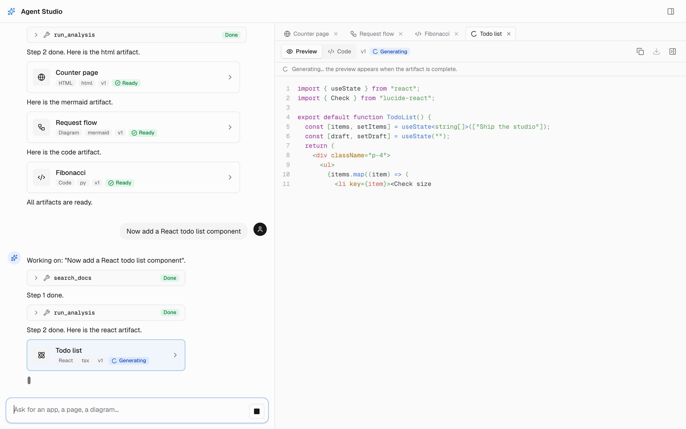
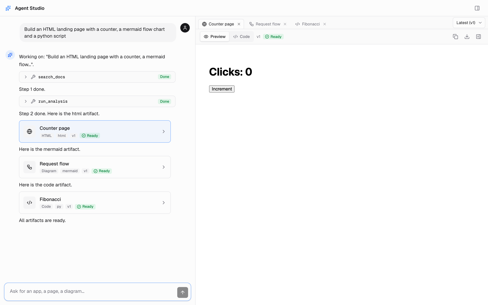
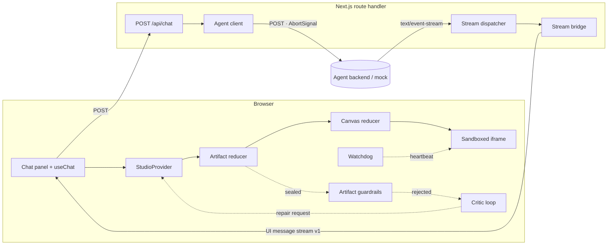

# Fullstack Agent Studio

**A split-pane agent workspace: a streaming chat on the left, a live artifact canvas on the right.**
Agents answer with text, tool calls and _artifacts_ (React components, HTML pages, SVG, Mermaid
diagrams, Markdown and source code). Artifacts stream into docked canvas tabs and run in a
locked-down sandbox only after they pass security inspection.


-16a34a)


<p align="center">
  
</p>
<p align="center"><sub>Real capture of the production build in mock mode: a React artifact mid-stream, with live
highlighting and docked tabs. Below: a finished HTML artifact running in the sandbox.</sub></p>
<p align="center">
  
  
</p>

## Contents

- [Highlights](#highlights)
- [Architecture](#architecture)
- [Quickstart](#quickstart)
- [Containers](#containers)
- [Quality gates](#quality-gates)
- [Test and chaos matrix](#test-and-chaos-matrix)
- [Repository layout](#repository-layout)
- [Documentation](#documentation)

## Highlights

- **Streaming end to end.** The agent's SSE stream is parsed incrementally, validated event by
  event and bridged to the [AI SDK UI Message Stream protocol v1](https://ai-sdk.dev/docs/ai-sdk-ui/stream-protocol),
  with backpressure from the browser all the way to the upstream socket.
- **Pure, replayable state.** Chat-independent reducers own artifacts (ordering, integrity,
  revisions) and the canvas (tabs, LRU eviction, pinned revisions); the UI only renders them.
- **Defense in depth.** Prompts are screened before they leave the browser and again on the
  server; every sealed artifact is inspected and quarantined if unsafe; previews run in an
  `allow-scripts`-only iframe under a nonce-based CSP with `connect-src 'none'`, watched by a
  heartbeat watchdog and a circuit breaker.
- **Self-healing.** Rejected artifacts get a line-level defect report sent back to the agent,
  at most twice per chain; rate limits and unreachable backends are retried with jittered
  backoff, and an artifact cut off by a dropped stream restarts cleanly on Retry.
- **Hermetic quality bar.** 1,300+ tests run without a single socket, DNS lookup or subprocess
  (enforced, not hoped for), with ≥ 90 % coverage required per module.

## Architecture



| Layer            | Where                                       | What it does                                                                                                                               |
| ---------------- | ------------------------------------------- | ------------------------------------------------------------------------------------------------------------------------------------------ |
| Data contracts   | [`src/lib/schemas/`](src/lib/schemas)       | Zod schemas for artifacts, stream events, canvas state and RFC 9457 problems; hard size limits in [`limits.ts`](src/lib/schemas/limits.ts) |
| State machine    | [`src/lib/core/`](src/lib/core)             | SSE framer and stream dispatcher; pure artifact and canvas reducers; sandbox preprocessor and markup sanitizer                             |
| Streaming engine | [`src/lib/tools/`](src/lib/tools)           | `/api/chat` handler, upstream agent client, stream bridge, mock agent, health endpoint                                                     |
| Guardrails       | [`src/lib/guardrails/`](src/lib/guardrails) | Input screening, artifact inspection, critic repair loop, sandbox watchdog                                                                 |
| Runner           | [`src/lib/runner/`](src/lib/runner)         | Preview documents: Sucrase JSX compilation, import maps, CSP, heartbeat injection                                                          |
| UI               | [`src/components/`](src/components)         | Split-pane layout, chat panel, canvas with tabs, viewer and sandboxed preview                                                              |

The full design, including the decisions behind it, is in
[docs/architecture.md](docs/architecture.md).

## Quickstart

Requirements: Node.js 24 LTS (see [`.nvmrc`](.nvmrc); 22.12+ also works) and pnpm 10 (the exact
version is pinned in `package.json` → `packageManager`).

```bash
pnpm install
cp .env.example .env.local        # then edit; never commit real values
AGENT_PROVIDER=mock pnpm dev      # fully offline: the built-in mock agent answers
```

Open <http://localhost:3000> and try one of the example prompts. With `AGENT_PROVIDER=upstream`
(the default) the studio streams from the agent at `BACKEND_SSE_URL` instead.

| Variable              | Scope   | Purpose                                                            |
| --------------------- | ------- | ------------------------------------------------------------------ |
| `BACKEND_SSE_URL`     | server  | Agent endpoint that streams the agent SSE protocol                 |
| `AGENT_PROVIDER`      | server  | `upstream` (default) or `mock` for the deterministic offline agent |
| `NEXT_PUBLIC_API_URL` | client  | Public base URL of the studio API                                  |
| `SKIP_ENV_VALIDATION` | tooling | Skips validation for CI lint/typegen only; never at runtime        |

Every variable is validated at build time and again when the server boots; a misconfigured
server refuses to start. Details: [docs/operations.md](docs/operations.md).

## Containers

The [`Dockerfile`](Dockerfile) builds the Next.js standalone server onto a distroless Node.js 24
image that runs as `nextjs:nodejs` (1001:1001) with a `HEALTHCHECK` on `/api/health`.

```bash
docker compose up --build                                  # studio on :3000, configured from .env.example (+ .env)
docker compose --profile offline up --build studio-offline # studio on :3001 → mock agent container, no internet route
scripts/docker-smoke.sh                                    # build, start, verify health, user and a chat turn
```

## Quality gates

```bash
pnpm verify   # Biome lint → strict typecheck → tests with coverage → attribution audit
pnpm bench    # engineering benchmarks (see docs/benchmarks.md)
```

| Script                         | Gate                                                                                                      |
| ------------------------------ | --------------------------------------------------------------------------------------------------------- |
| `pnpm lint`                    | Biome check, warnings are errors (0 diagnostics)                                                          |
| `pnpm typecheck`               | `next typegen` + `tsc --noEmit` with `exactOptionalPropertyTypes`, `noUncheckedIndexedAccess` and friends |
| `pnpm test`                    | Vitest with v8 coverage; ≥ 90 % branches, functions, lines and statements, overall and per module         |
| `scripts/audit-attribution.sh` | Every commit authored and committed by the sole contributor; no AI attribution trailers                   |

[GitHub Actions](.github/workflows/ci.yml) runs the same gates plus the production build, then
builds the container image and runs the smoke test against it.

## Test and chaos matrix

| Area                                      | Tests | What is proven                                                                                   |
| ----------------------------------------- | ----: | ------------------------------------------------------------------------------------------------ |
| Schemas and contracts                     |   399 | Every wire format accepts valid data and rejects malformed, oversized or hostile input           |
| Core reducers and stream engine           |   221 | Out-of-order and duplicate deltas, gaps, integrity checks, revisions, tab LRU invariants         |
| Streaming tools and routes                |   135 | Retries, timeouts, backpressure, client disconnects, RFC 9457 mapping, health and mock routes    |
| Guardrails and runner                     |   240 | Jailbreak and smuggling screens, XSS and exfiltration sinks, repair loop bounds, watchdog        |
| UI components                             |   124 | Chat, canvas, tabs, revisions, refusals, previews, keyboard and accessibility contracts          |
| End-to-end, chaos and stress              |    48 | Full pipeline through the real handler; dropped sockets, 429 storms, corrupt SSE, 100k artifacts |
| Container, CI, docs, config and isolation |   223 | Dockerfile, compose, workflow, docs and repository invariants; the hermetic network guard        |

Chaos findings that shaped the code are summarised in [docs/testing.md](docs/testing.md): a
dropped socket mid-artifact now recovers on Retry, 429 storms back off exponentially with jitter
and honour `Retry-After`, corrupt SSE frames are skipped without losing valid events, and a
100,000-character artifact crosses the whole server pipeline in about 2.5 ms in-process
([docs/benchmarks.md](docs/benchmarks.md)).

## Repository layout

```text
src/
  app/                 Next.js App Router: page, /api/chat, /api/health, /api/mock-agent
  components/          split-pane layout, chat/, canvas/, ui/ primitives
  lib/
    schemas/           Zod contracts and limits
    core/              stream dispatcher, reducers, sandbox preprocessor
    tools/             route handlers, agent client, stream bridge, mock agent
    guardrails/        input, artifact, critic and sandbox guards
    runner/            preview document builder
  instrumentation.ts   boot-time environment validation
tests/                 e2e, chaos, stress, hermetic, docker, ci and docs suites; fixtures; benchmarks
scripts/               attribution audit, container healthcheck and smoke test, screenshot capture
docs/                  architecture, operations, testing and benchmark write-ups; assets/
```

## Documentation

- [Architecture and design decisions](docs/architecture.md)
- [Operations: configuration, development, containers, CI](docs/operations.md)
- [Testing strategy, chaos findings and coverage](docs/testing.md)
- [Benchmarks](docs/benchmarks.md)
