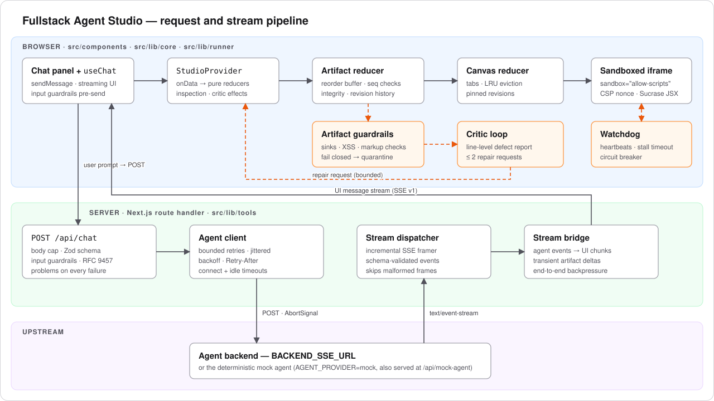
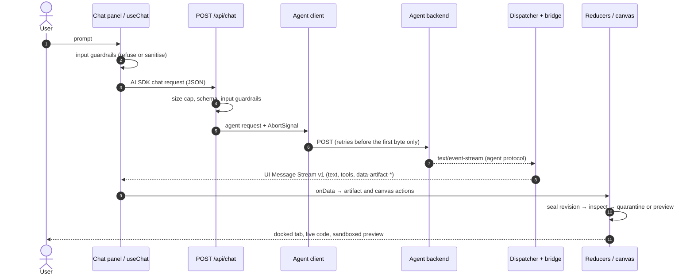

# Architecture and design decisions

The studio is a Next.js 15 App Router application with one streaming route (`POST /api/chat`)
and a client that keeps all interactive state in pure reducers. This document follows a
prompt from the keyboard to a running artifact, and records why each piece is shaped the way
it is.

- [Request lifecycle](#request-lifecycle)
- [Data contracts](#data-contracts)
- [State machine and pure reducers](#state-machine-and-pure-reducers)
- [Resilient streaming engine](#resilient-streaming-engine)
- [Defense-in-depth guardrails](#defense-in-depth-guardrails)
- [Sandboxed runner](#sandboxed-runner)
- [Error model](#error-model)
- [Decision log](#decision-log)

## Request lifecycle

1. **Before sending**, the chat panel runs the [input guardrails](#input-guardrails). A refused
   message stays in the composer with the reasons; nothing leaves the browser.
2. **`/api/chat`** ([`chat-handler.ts`](../src/lib/tools/chat-handler.ts)) reads the body under
   a byte cap, validates it against `ChatRequestSchema`, screens every user turn again (the
   browser check is a courtesy, this one is the gate), and maps the AI SDK message format to
   the agent's request format.
3. **The agent client** ([`agent-client.ts`](../src/lib/tools/agent-client.ts)) opens the
   upstream stream with connect and idle timeouts, retrying only failures that happen before a
   single byte of the answer exists.
4. **The stream dispatcher** ([`stream-dispatcher.ts`](../src/lib/core/stream-dispatcher.ts))
   frames SSE incrementally and validates each event; **the stream bridge**
   ([`stream-bridge.ts`](../src/lib/tools/stream-bridge.ts)) maps agent events to UI message
   chunks, which the AI SDK's own `createUIMessageStreamResponse` serialises.
5. **In the browser**, `useChat` renders text and tool calls, and its `onData` callback feeds
   artifact events into the reducers. Sealed artifacts are inspected; safe ones preview in the
   sandbox, unsafe ones are quarantined and reported back to the agent.

## Data contracts

Everything that crosses a boundary has a Zod schema in [`src/lib/schemas/`](../src/lib/schemas):
artifacts and their lifecycle events, the agent stream protocol, canvas state, chat requests,
UI message metadata and RFC 9457 problems. Types are always `z.infer` of a schema, never
written by hand (a contract test enforces this).

[`limits.ts`](../src/lib/schemas/limits.ts) caps every untrusted payload: 1,000,000 characters
per artifact, 64,000 per delta, 1 MiB per SSE frame, 12 canvas tabs, 20 revisions of history,
256 out-of-order deltas, 10 consecutive malformed frames. The limits are the memory model:
whatever the upstream sends, the client's footprint stays bounded.

## State machine and pure reducers

All interactive state lives in two pure reducers in [`src/lib/core/`](../src/lib/core). They
know nothing about React or the network, which is why they can be driven by the stream, by
tests, by benchmarks and by chaos schedules alike, and why no-op actions return the same object
(cheap re-render checks).

### Artifact reducer

[`artifact-reducer.ts`](../src/lib/core/artifact-reducer.ts) assembles artifacts from
`artifact-open` → `artifact-delta`* → `artifact-close` events.

- **Contiguous sequences.** Each delta carries a `seq`; the reducer appends only the next
  expected one. Duplicates are dropped and reported as diagnostics, never applied twice.
- **Reordering buffer.** Deltas that arrive early wait in a sorted `pending` buffer and are
  drained as soon as the gap fills. The buffer is bounded (`reorderWindow`), so a stream that
  skips ahead forever cannot grow memory.
- **Integrity.** `artifact-close` may state the expected `contentLength`; a mismatch, or a close
  with deltas still missing, fails the artifact instead of showing truncated code as complete.
- **Revisions and time travel.** Each sealed revision is snapshotted (with a content hash) into
  a bounded history. The canvas can pin any snapshot while newer revisions stream in, then
  unpin back to the live one.
- **Interruption and recovery.** When a response ends, every artifact still streaming becomes
  an `error` with an RFC 9457 `stream_interrupted` problem. If the agent later re-sends that
  same revision (a retried response), it restarts cleanly. A quarantined revision is flagged
  and can never be reopened.

### Canvas reducer

[`canvas-reducer.ts`](../src/lib/core/canvas-reducer.ts) owns tabs, the active tab, view modes,
pinned revisions and the split ratio. Tab recency is kept beside the persistable
`CanvasState`. When a 13th tab opens, the least recently used tab is evicted, never the one
being opened and never the active one. A 5,000-step seeded property test checks these
invariants after every action.

### Separation of concerns

Decoding (SSE framing, JSON, schemas) happens on the server; the client receives typed UI
message parts only. The reducers never see bytes and the UI never sees partial frames. Artifact
deltas travel as _transient_ data parts: they reach `onData` but are not stored in the chat
message, so a 100,000-character artifact exists once, in the artifact store, instead of being
re-sent with every later turn.

## Resilient streaming engine

| Concern          | Mechanism                                                                                                                                                                                                              | Where                                                                                                                   |
| ---------------- | ---------------------------------------------------------------------------------------------------------------------------------------------------------------------------------------------------------------------- | ----------------------------------------------------------------------------------------------------------------------- |
| Protocol         | Agent SSE events → AI SDK UI Message Stream v1 (`text-*`, `tool-*`, `data-artifact-*`, `finish`, `error`)                                                                                                              | [`stream-bridge.ts`](../src/lib/tools/stream-bridge.ts)                                                                 |
| Backpressure     | The bridge reads upstream only as fast as the browser consumes (`highWaterMark` + pull wake-ups); dispatcher callbacks run sequentially                                                                                | [`stream-bridge.ts`](../src/lib/tools/stream-bridge.ts), [`stream-dispatcher.ts`](../src/lib/core/stream-dispatcher.ts) |
| Cancellation     | Client disconnect or Stop aborts the request signal, which cancels the bridge, the dispatcher's reader and the upstream fetch; listeners and timers are released exactly once                                          | [`agent-client.ts`](../src/lib/tools/agent-client.ts)                                                                   |
| Connect timeout  | No response headers within 15 s → `timeout` problem (retryable)                                                                                                                                                        | agent client                                                                                                            |
| Idle watchdog    | No body chunk for 30 s → the upstream is torn down and the stream ends with a `timeout` problem                                                                                                                        | agent client                                                                                                            |
| Retries          | 429/502/503/504 and connection failures, at most twice, with exponential backoff and jitter (`min(4 s, 250 ms · 2ⁿ) · [0.5, 1)`); `Retry-After` is a floor, and one longer than 10 s is returned instead of waited for | agent client                                                                                                            |
| No replays       | A generation that has started streaming is never retried server-side; the user can Retry, and the artifact reducer restarts the interrupted revision                                                                   | agent client, artifact reducer                                                                                          |
| Malformed frames | Skipped and counted; ten in a row end the stream with an `invalid_frame` problem                                                                                                                                       | dispatcher                                                                                                              |

## Defense-in-depth guardrails

The guardrails in [`src/lib/guardrails/`](../src/lib/guardrails) assume the agent can be wrong
or hostile, and fail closed.

### Input guardrails

[`input-guardrails.ts`](../src/lib/guardrails/input-guardrails.ts) normalises text (NFKC,
control and invisible characters stripped, Unicode tag "smuggled" text decoded and screened),
builds a skeleton that folds leetspeak and look-alike letters, and blocks jailbreak phrasing,
role-marker and chat-template injection, and system-prompt extraction. It runs in the browser
before sending and in `/api/chat` for every user turn, including forged history.

### Artifact guardrails

[`artifact-guardrails.ts`](../src/lib/guardrails/artifact-guardrails.ts) inspects each sealed
revision and scores it; any critical or high defect quarantines it before it can run.

- **Exfiltration and escape sinks:** `document.cookie`, `localStorage`/`sessionStorage`/
  `indexedDB`, `window.parent`/`top`/`opener`, `fetch`/`XMLHttpRequest`/`WebSocket`/
  `sendBeacon`, navigation (`location = …`, `window.open`).
- **Dynamic code:** `eval`, `new Function`, string timers.
- **Markup (XSS/mXSS):** `</script>` breakouts hidden in strings, `javascript:` URLs, embedded
  frames, `<base>`, meta refresh and forms posting off-site block; inline event handlers are
  flagged and their code is scanned with the sink rules above. External resources outside the
  CDN allowlist and unbalanced HTML tags are advisory (medium); unbalanced SVG blocks.
- **Syntax:** React artifacts must compile with Sucrase _and_ have matching JSX tags (Sucrase
  accepts `
`); Mermaid must start with a known diagram type and carry no directives.
- **Runaway loops:** `while (true)` and friends with no `break`, `return`, `throw`, `await` or
  `yield`.

Every defect has a rule, severity, line, column and excerpt, which is what makes repair
possible.

### Critic repair loop

[`critic-loop.ts`](../src/lib/guardrails/critic-loop.ts) turns a failed inspection into a
schema-validated report and a deterministic repair request ("fix these lines, send revision
n + 1"). The provider sends it automatically after the response ends, **at most twice per
chain** of automatic repairs (counted across new artifact ids, so an agent cannot loop by
renaming), once per revision, and the budget resets only when the user writes. It can be turned
off with `<Studio autoRepair={false}>`.

### Sandbox watchdog

[`sandbox-guard.ts`](../src/lib/guardrails/sandbox-guard.ts) injects a heartbeat into every
preview. No first heartbeat within 15 s, or silence for 4 s, shuts the frame down with a
"Run again" option; content that hangs twice trips a circuit breaker and stays disabled.
Runtime errors inside the frame are relayed to the canvas. Messages are accepted only from that
frame's window and with its per-run token.

## Sandboxed runner

[`preview.ts`](../src/lib/runner/preview.ts) and
[`sandbox-preprocessor.ts`](../src/lib/core/sandbox-preprocessor.ts) build a self-contained
`srcdoc` document per preview.

- **Isolation:** `<iframe sandbox="allow-scripts">` without `allow-same-origin`, so the frame
  runs in an opaque origin with no access to the studio's cookies, storage or DOM.
- **CSP:** `default-src 'none'`; scripts only with the per-render nonce
  (`script-src 'nonce-…'`) or from the jsDelivr CDN; `connect-src`, `frame-src`, `worker-src`,
  `object-src`, `form-action` and `base-uri` are all `'none'`.
- **React artifacts** are compiled in the browser with Sucrase (TypeScript + JSX, no `eval`
  and no `'unsafe-eval'`), loaded as a `blob:` module by a nonce'd bootstrap, and resolve their
  imports through a pinned import map (React 19, lucide-react, recharts, clsx).
- **Fail closed:** the preview builder re-runs the artifact inspection itself, so even a
  caller that skipped the store's quarantine cannot get an unsafe document built.
- **Other types:** HTML is sanitised and wrapped; SVG renders as a sanitised `data:` image;
  Mermaid renders inside the same sandbox; Markdown renders in the page through a safe
  Markdown renderer; source code is display-only.

## Error model

Every failure is an RFC 9457 `application/problem+json` document with a typed `code`
(`rate_limited`, `stream_interrupted`, `input_rejected`, `artifact_rejected`, …), a canonical
status and a `retryable` flag ([`problem.ts`](../src/lib/schemas/problem.ts)). Before streaming
starts it is the HTTP response; after that it travels in-band as an `error` chunk whose text is
the problem JSON, so the chat can show the same title, detail and Retry either way.

## Decision log

| Decision                                                                 | Why                                                                                                                                                         |
| ------------------------------------------------------------------------ | ----------------------------------------------------------------------------------------------------------------------------------------------------------- |
| Bridge to the AI SDK UI Message Stream v1 instead of hand-written frames | `useChat` gets tool parts, data parts and metadata for free, and the SDK's own serialiser guarantees the framing matches its parser                         |
| Artifact deltas as transient data parts                                  | Keeps chat history small; artifacts live once in the store                                                                                                  |
| Pure reducers outside React                                              | Deterministic replay in tests, chaos schedules and benchmarks; trivially serialisable state                                                                 |
| Retries only before the first byte                                       | Replaying a generation that already streamed would duplicate text and artifacts                                                                             |
| Screen input on both sides                                               | The browser check gives instant feedback; the server check is the actual gate                                                                               |
| Inspect in the store _and_ in the preview builder                        | Two independent fail-closed layers; quarantine also removes the revision from history so it cannot be pinned                                                |
| Repair budget per chain, not per artifact                                | An agent answering with a new artifact id each time would otherwise loop forever                                                                            |
| Static loop detection plus a watchdog                                    | A frame that blocks its thread may share the studio's process; the static check prevents most hangs, the watchdog catches the rest once the thread frees up |
| Standalone server on distroless, non-root                                | Smallest runtime surface; only traced files ship; no shell or package manager in the image                                                                  |
